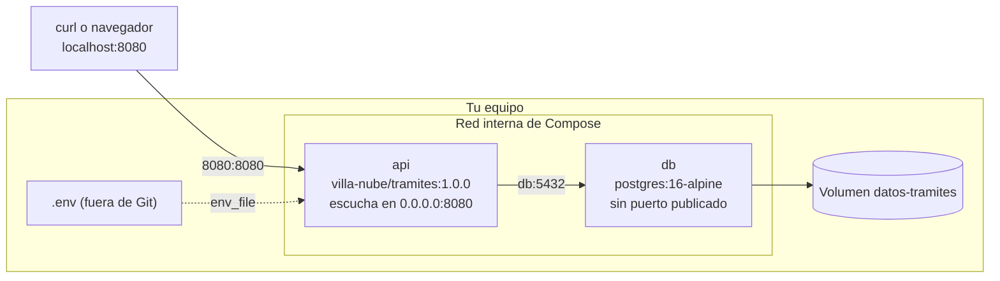

# Clase 3 · Guía del estudiante y ejercicios

Del draft al contenedor · Nube Intermedio · Semana 2. **No necesitas experiencia previa con Docker: vamos paso a paso.**

**Los ejercicios de la Clase 3** (cada clase numera sus ejercicios del 1 al 9: el «Ejercicio 7» de la Clase 3 no es el mismo de la Clase 4)

| # | Ejercicio | Modo | Tiempo |
| --- | --- | --- | --- |
| **1** | [¿Qué vas a empaquetar y cómo sabrás que funciona?](#ejercicio-1--qué-vas-a-empaquetar-y-cómo-sabrás-que-funciona) | En parejas · apertura | 5 min |
| **2** | [Sigue conmigo: tus primeros contenedores](#ejercicio-2--sigue-conmigo-tus-primeros-contenedores) | Individual, al mismo tiempo que el profesor | 10 min |
| **3** | [Construye y enciende Villa Nube](#ejercicio-3--construye-y-enciende-villa-nube) | En equipo · práctica guiada, parte A | 15 min |
| **4** | [Completa el Dockerfile](#ejercicio-4--completa-el-dockerfile) | En equipo · práctica guiada, parte B | 15 min |
| **5** | [¿Adentro o afuera?](#ejercicio-5--adentro-o-afuera) | Votación en el chat | 3 min |
| **6** | [Predice antes de ver](#ejercicio-6--predice-antes-de-ver) | Individual · durante la explicación | 5 min |
| **7** | [Tu proyecto en un contenedor](#ejercicio-7--tu-proyecto-en-un-contenedor) | Individual o con tu equipo de proyecto | 45 min |
| **8** | [Arranque a ciegas](#ejercicio-8--arranque-a-ciegas) | En parejas | 25 min |
| **9** | [Exit ticket y preparación para la Clase 4](#ejercicio-9--exit-ticket-y-preparación-para-la-clase-4) | Individual | 5 min |

## Antes de empezar

Hoy una parte de tu proyecto queda dentro de un contenedor: algo que cualquier persona puede encender igual en su computador. Al final, un compañero la va a encender siguiendo solo tus instrucciones.

**Te llevas:** un `Dockerfile`, tu imagen funcionando, dos pruebas escritas y un `README.md` con los pasos para encenderla.

**Cómo vamos a trabajar.** Primero lo hace el profesor, luego lo haces con él y después en tu proyecto. Copiar y pegar comandos está bien; lo importante es entender qué hizo cada uno. Si algo falla, copia el mensaje exacto en el chat: un error es información.

**Alistamiento (antes de la clase)**

- [ ] Docker Desktop instalado y abierto. Comprueba con `docker run hello-world`.
- [ ] Git instalado y una cuenta de GitHub.
- [ ] En Windows: Git Bash (viene con Git) para escribir los comandos.
- [ ] Tu lienzo de la Clase 2 a mano.

**¿No pudiste instalar Docker?** En la página de este repositorio en GitHub: botón **Code** → **Codespaces** → **Create codespace on main**. Se abre un editor en el navegador que ya trae Docker; en su terminal escribe `cd clases/clase-03/villa-nube`. Si tampoco funciona, trabaja en pareja con alguien de tu sala.

**Las 8 palabras de hoy**

| Palabra | Qué significa | Ejemplo |
| --- | --- | --- |
| Docker | La herramienta que crea y enciende contenedores | Docker Desktop |
| Dockerfile | Archivo de texto con la receta para armar la imagen | `FROM python:3.12-slim` |
| Imagen | La receta ya preparada y empacada. No cambia | `villa-nube/tramites:1.0.0` |
| Contenedor | Una imagen encendida y funcionando | El que creas con `docker run` |
| Puerto | La «puerta» por la que entras a la aplicación | `-p 8080:8080` |
| Variable de entorno | Un dato que le entregas al contenedor al encenderlo | `-e DIAS_VIGENCIA_DOCUMENTO=30` |
| Volumen | Un lugar para guardar datos fuera del contenedor | `datos-tramites` |
| Compose | Un archivo que enciende varios contenedores juntos | `docker compose up` |

**El laboratorio: Villa Nube.** Es la API de Trámites de la alcaldía ficticia de la Clase 2 y vive en la carpeta [`villa-nube/`](villa-nube/README.md) de esta clase. Todos los comandos de Villa Nube se ejecutan dentro de esa carpeta. Es un caso inventado: no uses datos personales reales ni claves de tu trabajo.

## Ejercicio 1 · ¿Qué vas a empaquetar y cómo sabrás que funciona?

*En parejas · apertura · 5 minutos.*

**Paso 1.** Mira tu lienzo de la Clase 2 y elige **una sola parte** de tu proyecto: la más importante. Por ejemplo, la API, el sitio web o el servicio principal.

La parte que voy a empaquetar: ______________________

**Paso 2.** Escribe dos pruebas completando esta frase: **«Si hago ___, debo ver ___»**.

Ejemplos con Villa Nube:

- Si abro `localhost:8080/salud`, debo ver «estado: ok» y la versión.
- Si radico una solicitud con un documento de hoy, debo recibir un número de solicitud.
- Si radico con un documento de 2020, debo ver «Documento vencido».

Mis dos pruebas:

1. Si hago ______________________, debo ver ______________________.
2. Si hago ______________________, debo ver ______________________.

**¿Está bien escrita?** Si otra persona puede hacer la prueba y decir «pasó» o «no pasó» sin preguntarte, sí. «Que funcione bien» no es una prueba.

¿No tienes proyecto o código todavía? Hoy trabaja con Villa Nube y usa las pruebas de ejemplo.

## Ejercicio 2 · Sigue conmigo: tus primeros contenedores

*Individual, al mismo tiempo que el profesor · 10 minutos.* Escribe cada comando en tu terminal y marca la casilla cuando veas el resultado.

**Primer contenedor**

```bash
docker run hello-world
```

- [ ] Veo el mensaje «Hello from Docker!».

Qué pasó: Docker buscó la imagen `hello-world`, la descargó de internet, encendió un contenedor, este imprimió el mensaje y se apagó.

**Un servidor web en un comando**

```bash
docker run -d -p 8080:80 --name web nginx
```

- [ ] Abro `http://localhost:8080` en el navegador y veo «Welcome to nginx!».

Qué significa cada parte:

| Parte | Significado |
| --- | --- |
| `-d` | Corre en segundo plano, para que puedas seguir usando la terminal |
| `-p 8080:80` | El puerto 8080 de tu computador lleva al puerto 80 del contenedor |
| `--name web` | Le pone un nombre fácil al contenedor |
| `nginx` | La imagen que se usa: un servidor web |

```bash
docker ps          # ver los contenedores encendidos
docker logs web    # ver lo que ha escrito el contenedor
docker stop web    # apagarlo
docker rm web      # borrarlo
```

- [ ] Después de `docker ps` veo una línea con `web` y `0.0.0.0:8080->80/tcp`.
- [ ] Después de `docker rm web`, `docker ps` ya no lo muestra.

Si algo no salió, escribe en el chat el comando que usaste y el error exacto.

## Ejercicio 3 · Construye y enciende Villa Nube

*En equipo · práctica guiada, parte A · 15 minutos.* Una persona comparte pantalla y las demás repiten cada paso en su computador.

**Paso 1 · Descarga el repositorio**

```bash
git clone https://github.com/dlemusg/Estud-IA-Nube-Int.git estudia-nube
cd estudia-nube/clases/clase-03/villa-nube
```

**Paso 2 · Lee el [Dockerfile](villa-nube/Dockerfile)** (ábrelo en tu editor). Esta es su versión corta, traducida:

| Línea | En palabras |
| --- | --- |
| `FROM python:3.12-slim` | Empieza con una imagen que ya trae Python |
| `WORKDIR /app` | Trabaja dentro de la carpeta /app |
| `COPY app/requirements.txt .` | Copia la lista de librerías |
| `RUN pip install -r requirements.txt` | Instala las librerías |
| `COPY app/ .` | Copia el código de la aplicación |
| `EXPOSE 8080` | Avisa que la aplicación usa el puerto 8080 |
| `CMD ["gunicorn", "--bind", "0.0.0.0:8080", "app:app"]` | Así se arranca la aplicación |

El archivo del repositorio tiene algunas líneas más (un usuario sin privilegios, la versión y una revisión de salud). Cada una tiene un comentario que la explica; no necesitas entenderlas todas hoy.

**Paso 3 · Construye la imagen** (la primera vez tarda un par de minutos)

```bash
docker build -t villa-nube/tramites:1.0.0 .
```

- [ ] Termina sin errores y `docker images` muestra `villa-nube/tramites` con la etiqueta `1.0.0`.

**Paso 4 · Enciéndela**

```bash
docker run -d -p 8080:8080 --name vn villa-nube/tramites:1.0.0
```

- [ ] Abro `http://localhost:8080/salud` y veo `{"estado":"ok","version":"..."}`.

**Paso 5 · Prueba una solicitud**

```bash
curl -X POST localhost:8080/solicitudes -H "Content-Type: application/json" -d "{\"ciudadano\":\"Ana\",\"fecha_documento\":\"2020-01-01\"}"
```

- [ ] Veo «Documento vencido»: la regla del negocio de la Clase 2 funciona dentro del contenedor.

**Paso 6 · Apágala antes de seguir**

```bash
docker rm -f vn
```

**Checkpoint (minuto 12).** Escriban en el chat general «Sala N: Villa Nube encendida» o el primer error.

## Ejercicio 4 · Completa el Dockerfile

*En equipo · práctica guiada, parte B · 15 minutos.* Abre [`docs/Dockerfile.plantilla`](villa-nube/docs/Dockerfile.plantilla) y completa cada `___` con una palabra del banco. Cada palabra se usa una vez.

**Banco de palabras:** `python:3.12-slim` · `/app` · `app/requirements.txt` · `requirements.txt` · `app/` · `8080` · `0.0.0.0`

```dockerfile
# 1. ¿Desde qué imagen empezamos? (Python ya instalado, versión pequeña)
FROM ___

# 2. ¿En qué carpeta de la imagen vamos a trabajar?
WORKDIR ___

# 3. Primero copiamos solo la lista de librerías...
COPY ___ .

# 4. ...y las instalamos
RUN pip install --no-cache-dir -r ___

# 5. Después copiamos el código de la aplicación
COPY ___ .

# 6. ¿En qué puerto escucha la aplicación?
EXPOSE ___

# 7. ¿Cómo arranca? Debe escuchar en TODAS las interfaces del contenedor
CMD ["gunicorn", "--bind", "___:8080", "app:app"]
```

Guárdalo en la carpeta `villa-nube` como `Dockerfile.mio` y constrúyelo:

```bash
docker build -f Dockerfile.mio -t villa-nube/tramites:0.1.0 .
docker run -d -p 8080:8080 --name mio villa-nube/tramites:0.1.0
```

- [ ] `http://localhost:8080/salud` responde.
- [ ] Al terminar: `docker rm -f mio`.

**Dos preguntas para el equipo**

1. ¿Por qué se copia primero la lista de librerías y después el código? *Pista: cambia una línea de `app/app.py`, vuelve a construir y mira qué pasos dicen `CACHED`.*
2. ¿Qué crees que pasaría si en la línea 7 pones `127.0.0.1` en lugar de `0.0.0.0`? Lo vemos después de la pausa.

## Ejercicio 5 · ¿Adentro o afuera?

*Votación en el chat · 3 minutos.* Para cada cosa de Villa Nube, escribe **A** si va dentro de la imagen o **F** si se le entrega al contenedor cuando lo enciendes.

Pista: si cambia entre tu computador y el servidor, o si es secreta, va afuera.

| # | Cosa | A o F |
| --- | --- | --- |
| 1 | Python | |
| 2 | El código de la aplicación | |
| 3 | La clave de la base de datos | |
| 4 | La dirección de la base de datos | |
| 5 | Las librerías | |
| 6 | Los datos de los ciudadanos | |

**Cómo se entrega lo de afuera:** con variables de entorno al encender el contenedor.

```bash
docker run -d -p 8080:8080 --name vn -e DIAS_VIGENCIA_DOCUMENTO=30 villa-nube/tramites:1.0.0
```

Cuando son muchas variables, se escriben en un archivo `.env`. Ese archivo **nunca** se sube a Git ni se mete en la imagen, porque puede tener claves.

## Lo que vas a ver: Compose y volúmenes

Cuando una aplicación necesita varios contenedores, por ejemplo una API y su base de datos, se describen juntos en un archivo [`compose.yaml`](villa-nube/compose.yaml) y se encienden con un solo comando. Hoy el profesor lo muestra; escribir tu propio `compose.yaml` es un reto opcional.



El navegador entra a la API por el puerto 8080. La API llama a la base de datos por su nombre, `db`. La base no se ve desde afuera y guarda sus datos en un volumen, para que no se pierdan si se borra el contenedor.

```bash
cp .env.ejemplo .env            # crea tu archivo de configuración
docker compose up -d --build    # construye y enciende todo
docker compose ps               # muestra el estado
./scripts/verificar.sh          # corre las pruebas: "5 pasaron, 0 fallaron"
docker compose down             # apaga todo (los datos se conservan)
```

## Ejercicio 6 · Predice antes de ver

*Individual · durante la explicación · 5 minutos.* Escribe tu predicción antes de que el profesor muestre el resultado. Equivocarse es parte del ejercicio.

**CMD y ENTRYPOINT**

| Dockerfile | Comando | Mi predicción | Lo que pasó |
| --- | --- | --- | --- |
| `CMD ["echo", "Hola"]` | `docker run imagen` | | |
| `CMD ["echo", "Hola"]` | `docker run imagen echo Adiós` | | |
| `ENTRYPOINT ["echo"]` y `CMD ["Hola"]` | `docker run imagen Adiós` | | |

Regla corta: **CMD es lo que corre si no dices nada. ENTRYPOINT es lo que corre siempre.**

**ARG y ENV**

| Pregunta | Mi predicción |
| --- | --- |
| Un `ARG VERSION` que usas al construir, ¿existe cuando el contenedor ya está encendido? | |
| Un `ENV SALUDO`, ¿lo puedes cambiar al encender con `-e SALUDO=Buenas`? | |
| ¿Alguno de los dos sirve para guardar una clave de forma segura? | |

Regla corta: **ARG vive solo mientras se construye. ENV vive también cuando corre.** Ninguno sirve para claves: los dos quedan guardados en la imagen.

**Volúmenes**

| Pregunta | Mi predicción |
| --- | --- |
| Hago `docker compose down` y luego `up`. ¿Sigue la solicitud que radiqué? | |
| ¿Y si hago `docker compose down -v`? | |

Para probarlo tú mismo: [`villa-nube/docs/ejemplos/`](villa-nube/docs/ejemplos/README.md) tiene los tres ejemplos con sus comandos.

## Ejercicio 7 · Tu proyecto en un contenedor

*Individual o con tu equipo de proyecto · 45 minutos.* Ahora lo haces con la parte que elegiste en el ejercicio 1.

**Paso 1 · Elige tu plantilla.** Están en [`villa-nube/docs/plantillas/`](villa-nube/docs/plantillas/). Cópiala a la carpeta de tu proyecto con el nombre `Dockerfile`.

| Tu proyecto es… | Usa | Puerto típico |
| --- | --- | --- |
| Python: Flask, FastAPI | [`Dockerfile.python`](villa-nube/docs/plantillas/Dockerfile.python) | 8080 o 5000 |
| Node.js: Express | [`Dockerfile.node`](villa-nube/docs/plantillas/Dockerfile.node) | 3000 |
| Sitio web estático: HTML, CSS, JavaScript | [`Dockerfile.web-estatica`](villa-nube/docs/plantillas/Dockerfile.web-estatica) | 80 |
| Otro lenguaje | Pide la plantilla en la sala de clínica | — |

**Paso 2 · Cambia lo que dice CAMBIA** en la plantilla: el puerto y el comando que arranca tu aplicación.

**Regla de oro:** tu aplicación debe escuchar en `0.0.0.0`, no en `localhost` ni en `127.0.0.1`. Si no, no vas a poder entrar desde el navegador.

**Paso 3 · Construye y enciende**

```bash
docker build -t mi-proyecto:0.1.0 .
docker run -d -p 8080:8080 --name mi-proyecto mi-proyecto:0.1.0
```

Cambia los dos `8080` por el puerto de tu aplicación si es otro. Para un sitio estático: `-p 8080:80`.

**Paso 4 · Comprueba tus dos pruebas** del ejercicio 1 y anota si pasaron.

**Paso 5 · Escribe tu README** con la plantilla [`villa-nube/docs/plantillas/README-plantilla.md`](villa-nube/docs/plantillas/README-plantilla.md).

**Paso 6 · Súbelo a GitHub** con `git add`, `git commit` y `git push`.

**¿No tienes código propio?** Usa Villa Nube: cambia el texto `"ok"` de `/salud` en `app/app.py` por un mensaje tuyo, reconstruye con la versión `0.2.0` y escribe el README de ese cambio. Es válido; decláralo en el README.

**Minuto 35.** Termina el README: en 10 minutos otra persona lo va a seguir sin tu ayuda.

## Ejercicio 8 · Arranque a ciegas

*En parejas · 25 minutos.* Si tu README está completo, otra persona podrá encender tu proyecto sin preguntarte nada.

1. A comparte el enlace de su repositorio y **no habla**.
2. B sigue solo el README, paso a paso.
3. Cuando B se detiene por una duda o un error, lo escribe en el chat. Solo entonces A puede ayudar.
4. A los 7 minutos intercambian.
5. Si B no puede ejecutar en su equipo, lee el README y marca el primer paso que no entendería.

**Lo anota B**

| Pregunta | Respuesta |
| --- | --- |
| ¿Hasta qué paso llegué sin ayuda? | |
| Primera duda o error | |
| ¿Vi lo que el README decía que iba a ver? | |

**Ajuste (5 minutos).** Cada autor corrige en su README la primera duda que tuvo su compañero.

## Ejercicio 9 · Exit ticket y preparación para la Clase 4

*Individual · 5 minutos.* Responde en el formulario o por chat privado al profesor.

1. En una frase: ¿qué es una imagen y qué es un contenedor?
2. ¿Cuál fue la primera duda de quien siguió tu README?
3. ¿Qué fue lo más difícil hoy?

**Antes de la Clase 4**

- [ ] Tu `Dockerfile` y tu `README.md` están en GitHub.
- [ ] En tu repositorio de GitHub, la pestaña *Actions* está habilitada.
- [ ] Platzi M1 · CI/CD. Mientras lo ves, piensa: «¿qué prueba debería correr sola cada vez que cambio el código?».

En la Clase 4, GitHub va a construir y probar tu proyecto solo, cada vez que lo cambies.

## Comandos, problemas frecuentes y retos

**Los comandos de hoy**

| Para qué | Comando |
| --- | --- |
| Construir una imagen | `docker build -t nombre:0.1.0 .` |
| Encender un contenedor | `docker run -d -p 8080:8080 --name n nombre:0.1.0` |
| Ver los contenedores encendidos | `docker ps` |
| Ver los mensajes y errores de un contenedor | `docker logs n` |
| Apagar y borrar un contenedor | `docker rm -f n` |
| Ver tus imágenes | `docker images` |
| Encender todo con Compose | `docker compose up -d --build` |
| Apagar todo con Compose | `docker compose down` |

**Si algo falla**

| Lo que pasa | Qué revisar |
| --- | --- |
| `Cannot connect to the Docker daemon` | Docker Desktop no está abierto. Ábrelo y espera a que diga que está corriendo |
| Docker Desktop no arranca en Windows | Hay que habilitar WSL 2 o la virtualización. Mientras tanto, usa Codespaces |
| `port is already allocated` | Otro contenedor usa ese puerto: `docker ps` y luego `docker rm -f` con su nombre. O usa otro puerto: `-p 9090:8080` |
| `The container name is already in use` | Ya existe un contenedor con ese nombre: `docker rm -f nombre` |
| El navegador no carga la página | ¿Pusiste `-p`? ¿Tu aplicación escucha en `0.0.0.0`? |
| El contenedor se apaga solo | `docker logs nombre`: el último mensaje dice por qué |
| Cambié el código y no se ve | Vuelve a construir (`docker build`) y vuelve a encender (`docker rm -f` y `docker run`) |
| `permission denied` al correr un script | `bash scripts/verificar.sh` |
| Mac con chip M: `exec format error` | Agrega `--platform linux/amd64` al construir |

**Retos opcionales, si terminas antes**

- Escribe un `compose.yaml` para tu proyecto con su base de datos (guíate por el de Villa Nube).
- Resuelve las fallas preparadas en la carpeta [`fallas/`](villa-nube/fallas/README.md).
- Agrega a tu imagen un usuario sin privilegios y un archivo `.dockerignore`.
- Compara `/salud` y `/listo` de Villa Nube con la base de datos apagada: `docker compose stop db`.
- Ayuda a otra persona de tu sala: explicar es la mejor forma de aprender.

> Material de apoyo generado con asistencia de IA y revisado por el profesor del curso.
