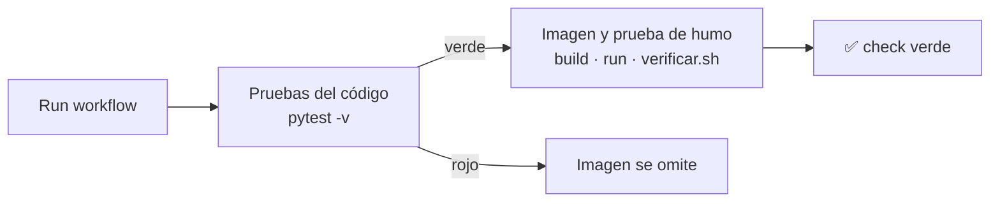

# Clase 4 · Paso a paso resuelto

Integración continua con GitHub Actions · Nube Intermedio · Semana 2.

Este documento recorre la Clase 4 **en el orden en que se hace**, con lo que debes ver en pantalla en cada paso y las respuestas de los ejercicios. Úsalo para repasar después de la clase o para ponerte al día si faltaste. La versión con botones «Siguiente» está en [`paso-a-paso.html`](paso-a-paso.html): ábrela en el navegador.

> [!NOTE]
> Las respuestas están plegadas (**▸ Ver respuesta**). Intenta cada ejercicio antes de abrirlas: equivocarse es parte del ejercicio.

**Mapa de la clase**

| # | Ejercicio | Modo | Tiempo | Te llevas |
| --- | --- | --- | --- | --- |
| 1 | ¿Qué debería revisar la máquina? | Parejas | 5 min | La prueba que vas a automatizar |
| 2 | Tu primera ejecución | Con el profesor | 10 min | Un ✅ en tu fork |
| 3 | Rompe y arregla | Equipo | 15 min | Enlace de un ❌ y de un ✅ |
| 4 | Completa el workflow | Equipo | 15 min | `mi-ci.yml` en verde |
| 5 | ¿Entorno o comportamiento? | Chat | 4 min | Leer un log rojo en 3 pasos |
| 6 | Predice antes de ver | Individual | 6 min | Qué garantiza un verde |
| 7 | Tu proyecto con CI | Individual | 45 min | Tu workflow, un rojo, un verde y «Cómo se valida» |
| 8 | ¿Qué te protege? | Parejas | 25 min | Revisión de otra persona |
| 9 | Exit ticket | Individual | 5 min | Listo para la Clase 5 |

---

## Ejercicio 1 · ¿Qué debería revisar la máquina?

**Paso 1.** Toma tus dos pruebas «Si hago ___, debo ver ___» de la Clase 3 y elige la que más te importaría que se comprobara sola **cada vez** que cambias el código.

**Paso 2.** Completa la frase: «Si alguien rompe ___, esta prueba lo detecta porque ___».

**Ejemplo resuelto con Villa Nube**

> Si alguien cambia **la regla de los 90 días**, la prueba «un documento vencido se rechaza» lo detecta porque **la solicitud ya no recibe el error 422**.

**Cómo saber si está bien elegida:** la prueba tiene que poder quedar en rojo cuando el comportamiento cambia. «Que el pipeline salga verde» no es una prueba: es un resultado.

---

## Ejercicio 2 · Tu primera ejecución

Todo se hace en el navegador.

### Paso 1 · Haz tu fork

1. Entra a `github.com/dlemusg/Estud-IA-Nube-Int`.
2. Pulsa **Fork** → **Create fork**.

✅ Debes estar en `github.com/TU-USUARIO/Estud-IA-Nube-Int`.

### Paso 2 · Habilita Actions

1. En tu fork, abre la pestaña **Actions**.
2. Pulsa el botón verde **I understand my workflows, go ahead and enable them**.

✅ A la izquierda aparece la lista de workflows, con **Clase 4 · Villa Nube CI**.

### Paso 3 · Corre el workflow a mano

**Clase 4 · Villa Nube CI** → **Run workflow** → **Run workflow**.

✅ Aparece una ejecución con un círculo amarillo que gira; en uno o dos minutos cambia a ✅.

### Paso 4 · Lee el log

Abre la ejecución → job **Pruebas del código** → paso **Correr las pruebas**. Debes leer:

```text
collected 5 items

tests/test_app.py::test_salud_informa_version PASSED                     [ 20%]
tests/test_app.py::test_listo_con_base_disponible PASSED                 [ 40%]
tests/test_app.py::test_radicar_y_consultar PASSED                       [ 60%]
tests/test_app.py::test_documento_vencido_se_rechaza PASSED              [ 80%]
tests/test_app.py::test_ciudadano_obligatorio PASSED                     [100%]

============================== 5 passed in 0.14s ===============================
```

Luego abre el job **Imagen y prueba de humo** → paso **Prueba de humo**:

```text
P1 · El servicio está vivo e informa su versión
  ✔ /salud → 200 {"estado":"ok","version":"a1b2c3d..."}
P2 · El servicio está listo: su base de datos responde
  ✔ /listo → 200
P3 · Un ciudadano radica una solicitud y puede consultarla
  ✔ POST /solicitudes → 201
  ✔ GET /solicitudes/4f0c... → 200
P4 · La regla del negocio se cumple: un documento vencido se rechaza
  ✔ documento vencido → 422

Resultado: 5 pasaron, 0 fallaron
```

**Qué pasó:** GitHub prestó una máquina Linux limpia, descargó el código, instaló Python y corrió las pruebas. Como pasaron, construyó la imagen, la encendió y repitió las pruebas de la Clase 3 contra el contenedor.



> [!TIP]
> ¿Sin GitHub hoy? El log completo está en [`villa-nube/ci/logs/1-verde.txt`](villa-nube/ci/logs/1-verde.txt).

---

## Ejercicio 3 · Rompe y arregla

### Paso 1 · Lee el workflow

Abre `.github/workflows/clase-04-villa-nube.yml` en tu fork. Las líneas que importan:

| Línea | En palabras |
| --- | --- |
| `on: push` con `paths` | Corre cuando subo un cambio dentro de la carpeta de Villa Nube |
| `workflow_dispatch` | Agrega el botón «Run workflow» |
| `permissions: contents: read` | El workflow solo puede leer el repositorio |
| `runs-on: ubuntu-latest` | Cada job corre en una máquina Linux limpia |
| `uses: actions/checkout@v6` | Descarga el código |
| `uses: actions/setup-python@v6` | Instala Python |
| `run: pytest -v` | Corre las pruebas |
| `needs: pruebas` | El job de la imagen solo corre si las pruebas pasaron |
| `if: failure()` | Este paso solo corre si algo falló antes |

### Paso 2 · Rompe la regla del negocio

Abre `clases/clase-04/villa-nube/app/app.py` → lápiz ✏️ → cambia la línea de `DIAS_VIGENCIA`:

```diff
- DIAS_VIGENCIA = int(os.getenv("DIAS_VIGENCIA_DOCUMENTO", "90"))
+ DIAS_VIGENCIA = int(os.getenv("DIAS_VIGENCIA_DOCUMENTO", "900"))
```

**Commit changes** → **Commit changes**.

✅ En **Actions** aparece una ejecución nueva que termina en ❌.

### Paso 3 · Encuentra el primer error útil

Ejecución roja → job **Pruebas del código** → paso **Correr las pruebas**:

```text
tests/test_app.py::test_documento_vencido_se_rechaza FAILED              [ 80%]

    def test_documento_vencido_se_rechaza(cliente):
        viejo = (date.today() - timedelta(days=91)).isoformat()
        r = cliente.post("/solicitudes", json={"ciudadano": "Ana", "fecha_documento": viejo})
>       assert r.status_code == 422
E       assert 201 == 422

FAILED tests/test_app.py::test_documento_vencido_se_rechaza - assert 201 == 422
========================= 1 failed, 4 passed in 0.13s ==========================
Error: Process completed with exit code 1.
```

<details>
<summary>▸ Ver respuesta</summary>

| Pregunta | Respuesta |
| --- | --- |
| ¿Qué job quedó en rojo? | **Pruebas del código**, en el paso «Correr las pruebas» |
| ¿Qué prueba falló? | `test_documento_vencido_se_rechaza` |
| ¿Qué esperaba y qué recibió? | Esperaba **422** (rechazado) y recibió **201** (creado): un documento de 91 días ahora se acepta |
| ¿Qué pasó con «Imagen y prueba de humo»? | **Se omitió** (⊘): tiene `needs: pruebas` y las pruebas fallaron |

</details>

### Paso 4 · Arréglalo

Vuelve a editar `app/app.py`, deja `"90"` y haz commit.

✅ La ejecución nueva termina en verde.
✅ Copia en tus notas el enlace de la ejecución roja y el de la verde: son tu evidencia.

**Checkpoint (minuto 12):** en el chat general, «Sala N: rojo y verde».

---

## Ejercicio 4 · Completa el workflow

Abre [`villa-nube/ci/plantilla-ci.yml`](villa-nube/ci/plantilla-ci.yml) y llena cada `___` con una palabra del banco: `push` · `ubuntu-latest` · `actions/checkout@v6` · `"3.12"` · `pytest -v` · `docker build` · `pruebas`.

<details>
<summary>▸ Ver respuesta: el workflow completo</summary>

```yaml
name: Mi primer CI

# 1. ¿Cuándo corre? Cada vez que subo un cambio
on:
  push:
    paths:
      - "clases/clase-04/villa-nube/**"

permissions:
  contents: read

defaults:
  run:
    working-directory: clases/clase-04/villa-nube

jobs:
  pruebas:
    # 2. ¿En qué máquina corre?
    runs-on: ubuntu-latest
    steps:
      # 3. Descargar el código
      - uses: actions/checkout@v6

      # 4. Versión de Python
      - uses: actions/setup-python@v6
        with:
          python-version: "3.12"

      - run: pip install -r app/requirements.txt -r requirements-dev.txt

      # 5. Correr las pruebas
      - run: pytest -v

  imagen:
    # 6. Espera a que «pruebas» termine en verde
    needs: pruebas
    runs-on: ubuntu-latest
    steps:
      - uses: actions/checkout@v6

      # 7. Construir la imagen
      - run: docker build -t villa-nube/tramites:${{ github.sha }} .
```

</details>

**Para probarlo:** en tu fork, **Add file** → **Create new file** → nombre `.github/workflows/mi-ci.yml` → pega tu versión → commit. Después cambia cualquier archivo de `clases/clase-04/villa-nube/` (por ejemplo, una línea del README) para dispararlo.

✅ **Mi primer CI** aparece en Actions y termina en verde.

> [!WARNING]
> Si GitHub dice «Invalid workflow file», es la sangría: usa espacios (nunca tabuladores) y copia los espacios de la plantilla. `python-version` va con comillas: sin ellas, `3.10` se leería como `3.1`.

<details>
<summary>▸ Ver respuesta: las dos preguntas para el equipo</summary>

1. **¿Por qué `needs: pruebas`?** Para no construir una imagen de un código que ya sabemos roto. Si las pruebas fallan, el job de la imagen se omite: el rojo llega antes y no se gasta tiempo.
2. **¿Por qué `${{ github.sha }}` y no `latest`?** El sha es el código exacto del commit: cada imagen dice de qué cambio salió y volver atrás es pedir la etiqueta anterior. `latest` se mueve con cada construcción y no dice nada.

</details>

---

## Ejercicio 5 · ¿Entorno o comportamiento?

**E** = faltaba algo para poder correr. **C** = corrió, pero hizo algo distinto de lo esperado.

| # | Lo que dice el log | E o C |
| --- | --- | --- |
| 1 | `FAILED test_documento_vencido_se_rechaza - assert 201 == 422` | |
| 2 | `pytest: command not found` | |
| 3 | `ModuleNotFoundError: No module named 'flask'` | |
| 4 | `/salud → 000` y en el contenedor: `Listening at: http://127.0.0.1:8080` | |

<details>
<summary>▸ Ver respuesta</summary>

| # | Respuesta | Por qué | Log guardado |
| --- | --- | --- | --- |
| 1 | **C** | La app corrió y respondió 201 donde la regla exige 422 | [`2-rojo-regla.txt`](villa-nube/ci/logs/2-rojo-regla.txt) |
| 2 | **E** | Se borró el paso «Instalar las librerías»: el comando no existe (código 127) | [`3-rojo-entorno.txt`](villa-nube/ci/logs/3-rojo-entorno.txt) |
| 3 | **E** | Falta Flask en `requirements.txt` | Falla 02 de [`fallas-ci/`](villa-nube/fallas-ci/README.md) |
| 4 | **E** | La app arrancó, pero escucha solo dentro del contenedor: nadie la puede alcanzar. `000` no es una respuesta de la app, es «no hubo conexión» | [`4-rojo-imagen.txt`](villa-nube/ci/logs/4-rojo-imagen.txt) |

</details>

**Cómo leer un log rojo, en tres pasos**

1. Busca el **primer** paso con ❌: los de después suelen fallar por culpa de ese.
2. Dentro del paso, busca las líneas con `Error`, `FAILED` o `E `.
3. Pregúntate: ¿faltaba algo para correr (entorno) o corrió y respondió distinto (comportamiento)?

---

## Ejercicio 6 · Predice antes de ver

Escribe tu predicción **antes** de abrir la respuesta.

| Pregunta | Mi predicción |
| --- | --- |
| Si «Pruebas del código» falla, ¿corre «Imagen y prueba de humo»? | |
| Cambio `run: pytest -v` por <code>run: pytest -v &#124;&#124; true</code> y rompo la regla. ¿De qué color queda? | |
| Cambio solo el README de la raíz. ¿Corre el workflow de Villa Nube? | |
| El workflow quedó en verde. ¿Villa Nube ya está publicada en internet? | |

<details>
<summary>▸ Ver respuesta</summary>

| Pregunta | Lo que pasa |
| --- | --- |
| ¿Corre la imagen si las pruebas fallan? | **No.** Se omite por `needs: pruebas` |
| <code>pytest -v &#124;&#124; true</code> con la regla rota | **Verde, y engaña.** El log dice `1 failed`, pero <code>&#124;&#124; true</code> hace que el paso termine en 0. La prueba de humo también pasa: usa un documento de 2020, que sigue vencido aun con 900 días. Ver [`5-verde-enganoso.txt`](villa-nube/ci/logs/5-verde-enganoso.txt) |
| Solo el README de la raíz | **No corre.** El filtro `paths` solo mira `clases/clase-04/villa-nube/**` y el propio workflow |
| ¿Verde = publicada? | **No.** La imagen se construyó y se probó en el runner, que se borra al terminar. Publicar y desplegar llega en las clases siguientes |

**Regla corta:** un check verde solo garantiza lo que realmente se probó.

</details>

**¿Dónde vive cada dato?** Opciones: **secreto de GitHub**, **variable de GitHub** o **`.env` en tu equipo**.

| Dato | ¿Dónde va? |
| --- | --- |
| La clave de la base de datos de producción | |
| El número de días de vigencia del documento | |
| La clave de tu base de datos local para practicar | |

<details>
<summary>▸ Ver respuesta</summary>

| Dato | Va en | Por qué |
| --- | --- | --- |
| Clave de producción | **Secreto** (Settings → Secrets and variables → Actions → Secrets) | Es sensible: GitHub la tapa con `***` en el log |
| Días de vigencia | **Variable** (la misma pantalla → Variables) | No es sensible, pero puede cambiar sin tocar el código |
| Clave local | **`.env`** en tu equipo | Solo existe en tu computador; `.env` está en `.gitignore` y nunca se sube |

</details>

---

## Ejercicio 7 · Tu proyecto con CI

El ejemplo resuelto usa **Mercado Raíces** (Python), uno de los proyectos de práctica. Si tienes tu propio proyecto, haz lo mismo con tus valores.

### Paso 0 · Elige tu proyecto

| Proyecto | Tecnología | Carpeta | Plantilla |
| --- | --- | --- | --- |
| Mercado Raíces | Python · Flask | `proyectos/mercado-raices` | `ci-python.yml` |
| BiciBarrio | Node.js · Express | `proyectos/bici-barrio` | `ci-node.yml` |
| Biblioteca La Esquina | Sitio estático | `proyectos/biblioteca-barrio` | `ci-docker.yml` |
| Tu proyecto con Dockerfile y sin pruebas | Cualquiera | `.` | `ci-docker.yml` |

### Paso 1 y 2 · Crea el workflow desde la plantilla

**Add file** → **Create new file** → nombre `.github/workflows/mercado-raices.yml` (en tu propio repositorio: `.github/workflows/ci.yml`) → pega [`ci-python.yml`](villa-nube/ci/plantillas/ci-python.yml).

### Paso 3 · Cambia lo que dice CAMBIA

```diff
 defaults:
   run:
-    working-directory: "."
+    working-directory: "proyectos/mercado-raices"

 env:
   PUERTO_APP: "8080"
 ...
-      - name: "Prueba 1 · CAMBIA: escribe aquí tu frase"
+      - name: "Prueba 1 · Si abro /productos, debo ver Papa criolla"
         run: |
-          curl -s http://localhost:9000/ | tee respuesta.txt
-          grep -q "TEXTO QUE DEBES VER" respuesta.txt
+          curl -s http://localhost:9000/productos | tee respuesta.txt
+          grep -q "Papa criolla" respuesta.txt
```

### Paso 4 · Commit y mira Actions

✅ Tu workflow termina en verde. Si queda en rojo, aplica los tres pasos del ejercicio 5 antes de pedir ayuda.

### Paso 5 · Provoca un rojo a propósito y arréglalo

En `proyectos/mercado-raices/app/app.py`:

```diff
- PEDIDO_MINIMO = int(os.getenv("PEDIDO_MINIMO", "20000"))
+ PEDIDO_MINIMO = int(os.getenv("PEDIDO_MINIMO", "2000"))
```

<details>
<summary>▸ Ver respuesta: ¿qué falla?</summary>

Falla `test_pedido_minimo` en el job **Pruebas del código**: el pedido de una sola cebolla (2.500 pesos) ya supera el mínimo, así que se crea (`201`) en lugar de rechazarse (`422`). El job de la imagen se omite. Deshaz el cambio y comprueba que vuelve a verde.

</details>

✅ Tienes el enlace de una ejecución roja y de una verde de tu proyecto.

### Paso 6 · Agrega «Cómo se valida» a tu README

Ejemplo resuelto para Mercado Raíces:

```markdown
## Cómo se valida

Cada vez que se sube un cambio, GitHub Actions corre el workflow `.github/workflows/mercado-raices.yml`:

1. Corre las 6 pruebas del código con pytest (salud, productos, pedido válido, pedido mínimo, producto desconocido, sin existencias).
2. Construye la imagen, la enciende y comprueba: «Si abro /productos, debo ver Papa criolla».

Si algo falla, el check queda en rojo y el cambio no se considera listo.

Lo que todavía NO se valida: que los pedidos sobrevivan a un reinicio (viven en memoria), el despliegue y la seguridad.
```

**Minuto 35:** asegúrate de tener el rojo y el verde; en 10 minutos otra persona revisa tu workflow.

---

## Ejercicio 8 · ¿Qué te protege?

1. **A** comparte el enlace de su repositorio y de su última ejecución verde, y **no explica nada**.
2. **B** abre el workflow y el log, y llena la tabla.
3. **A** hace en vivo un cambio que su prueba debería detectar. Los dos miran si queda en rojo.
4. A los 10 minutos intercambian. Después, 5 minutos de ajuste.

**Ejemplo de lo que anota B para Mercado Raíces**

| Pregunta | Respuesta |
| --- | --- |
| ¿Qué prueba protege este cambio? | `test_pedido_minimo` y la prueba de humo de `/productos` |
| Si la prueba falla, ¿qué pasa? | El check queda en rojo, la imagen no se construye y GitHub avisa al autor del commit |
| ¿Qué NO está probando? | Que los pedidos se guarden tras un reinicio; que el servicio esté publicado |
| ¿El cambio en vivo quedó en rojo? | Sí: con `"2000"` falló `test_pedido_minimo` |

---

## Ejercicio 9 · Exit ticket y preparación para la Clase 5

1. En una frase: ¿qué hace tu workflow cada vez que subes un cambio?
2. ¿Qué parte de tu proyecto todavía se revisa o se configura a mano?
3. ¿Qué fue lo más difícil hoy?

**Antes de la Clase 5**

- [ ] Tu workflow y tu sección «Cómo se valida» están en GitHub.
- [ ] Guardaste el enlace de una ejecución roja y de una verde.
- [ ] Avanzaste en el módulo de Platzi de la semana, pensando: «¿qué parte de mi infraestructura configuro hoy a mano y cómo la describiría en un archivo?».

> Material de apoyo generado con asistencia de IA y revisado por el profesor del curso.
