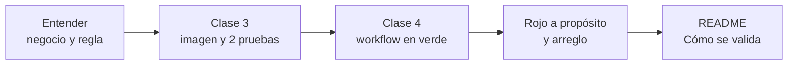

# Biblioteca La Esquina · Paso a paso resuelto

Proyecto de práctica del curso Estud-IA · Nube Intermedio. Sitio estático (HTML, CSS y JavaScript) servido por nginx.

Este documento desarrolla el proyecto completo, **en el orden en que se hace en las clases**: primero lo entiendes, en la Clase 3 lo metes en un contenedor y en la Clase 4 le pones integración continua. Para cada paso dice qué escribir y qué debes ver. La versión con botones «Siguiente» está en [`paso-a-paso.html`](paso-a-paso.html): ábrela en el navegador.

> [!NOTE]
> Las respuestas están plegadas (**▸ Ver respuesta**). Intenta cada pregunta antes de abrirlas.



| Fase | Pasos | Te llevas |
| --- | --- | --- |
| Entender el proyecto | 1–2 | El negocio, la regla y qué hace cada archivo |
| Clase 3 · Contenedor | 3–6 | La imagen funcionando y dos pruebas «Si hago ___, debo ver ___» |
| Clase 4 · Integración continua | 7–13 | Un workflow en verde, dos rojos provocados y leídos, y el arreglo |
| Cierre | 14–17 | Un reto opcional, la sección «Cómo se valida» y la revisión en parejas |

---

## Parte 1 · Entender el proyecto

### Paso 1 · El negocio y la regla

La Biblioteca La Esquina funciona en la casa de la cultura del barrio y presta libros donados. Hoy los vecinos llaman por teléfono para preguntar si un libro está disponible. El sitio publica el catálogo con un buscador y muestra qué libros están prestados.

**La regla del negocio vive en los datos:** un libro con `"disponible": false` se muestra como «Prestado».

### Paso 2 · Qué hay en la carpeta

```text
proyectos/biblioteca-barrio/
├── Dockerfile          dos instrucciones: nginx y copiar sitio/
├── .dockerignore       deja fuera .git y los .md
└── sitio/
    ├── index.html      la página
    ├── estilos.css     colores y forma
    ├── catalogo.js     el buscador: lee libros.json y filtra mientras escribes
    └── libros.json     los datos: 6 libros, 2 prestados
```

No hay código de servidor: nginx entrega los archivos tal como están. El JavaScript corre **en el navegador** del visitante, no en el contenedor.

<details>
<summary>▸ Ver respuesta: ¿qué libros salen como «Prestado»?</summary>

*La vorágine* (José Eustasio Rivera) y *El olvido que seremos* (Héctor Abad Faciolince): son los dos que tienen `"disponible": false` en `sitio/libros.json`.

</details>

---

## Parte 2 · Clase 3 · Del proyecto al contenedor

### Paso 3 · Lee el Dockerfile

```dockerfile
# Biblioteca La Esquina · sitio web estático
FROM nginx:1.27-alpine

# nginx sirve todo lo que esté en esta carpeta
COPY sitio/ /usr/share/nginx/html/

EXPOSE 80
# La imagen de nginx ya trae su CMD: no hace falta escribirlo
```

| Línea | En palabras |
| --- | --- |
| `FROM nginx:1.27-alpine` | Parte de una imagen que ya trae el servidor web nginx, en su versión liviana |
| `COPY sitio/ /usr/share/nginx/html/` | Copia la carpeta `sitio/` a la carpeta que nginx publica |
| `EXPOSE 80` | Documenta que nginx escucha en el puerto **80** dentro del contenedor (no lo publica) |
| (sin `CMD`) | La imagen de nginx ya sabe cómo arrancar |

### Paso 4 · Construye y enciende

Dentro de `proyectos/biblioteca-barrio`:

```bash
docker build -t biblioteca:0.1.0 .
docker run -d -p 9000:80 --name biblioteca biblioteca:0.1.0
docker ps
```

✅ `docker ps` muestra el contenedor `biblioteca` con `0.0.0.0:9000->80/tcp`.

`-p 9000:80` quiere decir: lo que llegue al puerto **9000 de tu equipo** pasa al puerto **80 del contenedor**, donde escucha nginx.

### Paso 5 · Ábrelo en el navegador

Abre <http://localhost:9000>.

✅ Ves el título «Biblioteca La Esquina», un buscador y el resumen «6 de 6 libros · 4 disponibles».
✅ Al escribir «García» en el buscador queda solo *Cien años de soledad*.

### Paso 6 · Escribe tus dos pruebas

| # | Si hago… | Debo ver… |
| --- | --- | --- |
| 1 | Abro `/` | «Biblioteca La Esquina» |
| 2 | Abro `/libros.json` | «Cien años de soledad» |

Compruébalas con `curl` (en Windows, en Git Bash):

```bash
curl -s http://localhost:9000/ | grep "Biblioteca La Esquina"
curl -s http://localhost:9000/libros.json | grep "Cien años de soledad"
```

✅ Cada comando imprime la línea donde aparece el texto. Si no imprime nada, la prueba no pasó.

<details>
<summary>▸ Ver respuesta: ¿por qué la prueba 2 abre <code>/libros.json</code> y no busca el libro en <code>/</code>?</summary>

Porque `curl` no ejecuta JavaScript. La lista de libros la dibuja `catalogo.js` en el navegador, después de cargar la página. Lo que `curl` recibe de `/` es el `index.html` vacío de libros: ahí está el título, pero no *Cien años de soledad*. Los datos sí están en `/libros.json`, que nginx entrega tal cual.

</details>

Para apagarlo:

```bash
docker rm -f biblioteca
```

---

## Parte 3 · Clase 4 · Integración continua

### Paso 7 · Prepara tu fork

Si no lo hiciste en la Clase 4:

1. En `github.com/dlemusg/Estud-IA-Nube-Int`, **Fork** → **Create fork**.
2. En tu fork, pestaña **Actions** → **I understand my workflows, go ahead and enable them**.

### Paso 8 · Crea el workflow desde la plantilla

1. Abre la plantilla [`clases/clase-04/villa-nube/ci/plantillas/ci-docker.yml`](../../clases/clase-04/villa-nube/ci/plantillas/ci-docker.yml) y copia todo su contenido.
2. En tu fork: **Add file** → **Create new file**.
3. Nombre del archivo: `.github/workflows/biblioteca-barrio.yml` (en la raíz del repositorio).
4. Pega la plantilla. Todavía no hagas commit.

Se usa `ci-docker.yml` porque el proyecto tiene Dockerfile pero no tiene pruebas automáticas de código (no hay pytest ni `npm test`): todo se prueba con el contenedor encendido.

### Paso 9 · Cambia lo que dice CAMBIA

| CAMBIA | Valor | Por qué |
| --- | --- | --- |
| `working-directory` | `"proyectos/biblioteca-barrio"` | Ahí está el Dockerfile dentro del fork |
| `PUERTO_APP` | `"80"` | nginx escucha en el 80 dentro del contenedor |
| Prueba 1 | ruta `/` y texto `Biblioteca La Esquina` | Tu prueba 1 de la Clase 3 |
| Prueba 2 | ruta `/libros.json` y texto `Cien años de soledad` | Tu prueba 2 de la Clase 3 |

Recomendado, aunque la plantilla no lo pide: cambia `name: CI` por `name: Biblioteca La Esquina CI` para distinguirlo en Actions de otros workflows.

<details>
<summary>▸ Ver respuesta: el workflow completo</summary>

```yaml
name: Biblioteca La Esquina CI

on:
  push:
  pull_request:
  workflow_dispatch:

permissions:
  contents: read

defaults:
  run:
    working-directory: "proyectos/biblioteca-barrio"

env:
  # nginx escucha en el 80 dentro del contenedor
  PUERTO_APP: "80"

jobs:
  imagen:
    name: Imagen y prueba de humo
    runs-on: ubuntu-latest
    steps:
      - name: Descargar el código
        uses: actions/checkout@v6

      - name: Construir la imagen
        run: docker build -t mi-proyecto:${{ github.sha }} .

      - name: Encender el contenedor
        run: docker run -d -p 9000:${{ env.PUERTO_APP }} --name app mi-proyecto:${{ github.sha }}

      - name: Esperar a que responda
        run: |
          for i in $(seq 1 30); do
            curl -s -o /dev/null http://localhost:9000/ && exit 0
            sleep 1
          done
          echo "La aplicación no respondió en 30 segundos"
          exit 1

      - name: "Prueba 1 · Si abro /, debo ver Biblioteca La Esquina"
        run: |
          curl -s http://localhost:9000/ | tee respuesta.txt
          grep -q "Biblioteca La Esquina" respuesta.txt

      - name: "Prueba 2 · Si abro /libros.json, debo ver Cien años de soledad"
        run: |
          curl -s http://localhost:9000/libros.json | tee respuesta.txt
          grep -q "Cien años de soledad" respuesta.txt

      - name: Logs del contenedor (si algo falló)
        if: failure()
        run: docker logs app
```

</details>

**Qué hace cada paso**

| Paso | Qué hace |
| --- | --- |
| Descargar el código | Trae tu fork a la máquina limpia de GitHub |
| Construir la imagen | `docker build` con el Dockerfile del proyecto; la etiqueta es el código del commit |
| Encender el contenedor | Publica el 9000 del runner hacia el 80 del contenedor |
| Esperar a que responda | Intenta durante 30 segundos; si nginx no contesta, falla |
| Prueba 1 y 2 | `curl` pide la página y `tee` la muestra en el log; **`grep -q` es el que decide**: si no encuentra el texto, sale con 1 y el paso queda en rojo |
| Logs del contenedor | Solo si algo falló: muestra lo que escribió nginx |

### Paso 10 · Commit y primera ejecución

**Commit changes** → **Commit changes**. Luego abre **Actions**.

✅ Aparece **Biblioteca La Esquina CI** con una ejecución que termina en verde (alrededor de un minuto).

Abre la ejecución → job **Imagen y prueba de humo**. Debes ver todos los pasos con ✓ y el de logs omitido:

```text
✓ Descargar el código
✓ Construir la imagen
✓ Encender el contenedor
✓ Esperar a que responda
✓ Prueba 1 · Si abro /, debo ver Biblioteca La Esquina
    <title>Biblioteca La Esquina · Catálogo</title>
    ...
    <h1>Biblioteca La Esquina</h1>
✓ Prueba 2 · Si abro /libros.json, debo ver Cien años de soledad
    {"titulo": "Cien años de soledad", "autor": "Gabriel García Márquez", "disponible": true},
⊘ Logs del contenedor (si algo falló)
```

> [!WARNING]
> **El verde que engaña.** `curl -s` termina en 0 aunque la página responda 404. Si borras la línea `grep -q`, la prueba queda verde con cualquier respuesta. Una prueba es útil solo si puede quedar en rojo.

### Paso 11 · Provoca un rojo: borra un libro

En tu fork abre `proyectos/biblioteca-barrio/sitio/libros.json` → lápiz ✏️ → borra la línea de *Cien años de soledad*:

```diff
   "libros": [
-    {"titulo": "Cien años de soledad", "autor": "Gabriel García Márquez", "disponible": true},
     {"titulo": "La vorágine", "autor": "José Eustasio Rivera", "disponible": false},
```

Haz commit. El JSON sigue siendo válido: la línea que borraste terminaba en coma.

✅ La ejecución nueva termina en rojo.

```text
✓ Esperar a que responda
✓ Prueba 1 · Si abro /, debo ver Biblioteca La Esquina
✗ Prueba 2 · Si abro /libros.json, debo ver Cien años de soledad
    Run curl -s http://localhost:9000/libros.json | tee respuesta.txt
    {
      "biblioteca": "Biblioteca La Esquina",
      "libros": [
        {"titulo": "La vorágine", "autor": "José Eustasio Rivera", "disponible": false},
        ...
    Error: Process completed with exit code 1.
✓ Logs del contenedor (si algo falló)
    172.17.0.1 - - "GET / HTTP/1.1" 200 ...
    172.17.0.1 - - "GET /libros.json HTTP/1.1" 200 ...
```

<details>
<summary>▸ Ver respuesta: lee el rojo</summary>

| Pregunta | Respuesta |
| --- | --- |
| ¿Qué paso quedó en rojo? | **Prueba 2**. La prueba 1 pasó: el título sigue ahí |
| ¿Cuál es el primer mensaje útil? | No hay un «Error» de texto: `grep -q` no imprime nada. Lo útil es la respuesta que `tee` dejó en el log: el libro ya no está |
| ¿Qué dicen los logs de nginx? | `GET /libros.json` respondió **200**: el sitio funciona y entregó el archivo |
| ¿Entorno o comportamiento? | **Comportamiento**: el sitio corrió y respondió, pero sin el contenido esperado |

</details>

### Paso 12 · Un segundo rojo: el puerto equivocado

Ahora una falla de otro tipo. Deshaz el cambio de `libros.json` y, en el workflow, cambia el puerto:

```diff
 env:
-  PUERTO_APP: "80"
+  PUERTO_APP: "8080"
```

```text
✓ Construir la imagen
✓ Encender el contenedor
✗ Esperar a que responda
    La aplicación no respondió en 30 segundos
    Error: Process completed with exit code 1.
⊘ Prueba 1 · Si abro /, debo ver Biblioteca La Esquina
⊘ Prueba 2 · Si abro /libros.json, debo ver Cien años de soledad
✓ Logs del contenedor (si algo falló)
    ... nginx/1.27 ... start worker processes
```

<details>
<summary>▸ Ver respuesta: ¿qué pasó y de qué tipo es?</summary>

El contenedor arrancó bien (los logs muestran a nginx encendido), pero el workflow conecta el 9000 del runner con el **8080** del contenedor, donde nadie escucha: nginx está en el 80. Ninguna petición llega, el paso de espera se rinde a los 30 segundos y las pruebas se omiten.

Es una falla de **entorno**: el sitio no tiene nada mal; la configuración no lo deja alcanzar. Se revisa `PUERTO_APP` contra el `EXPOSE` del Dockerfile.

</details>

**Clasifica estos tres rojos**

| Lo que dice el log | E o C |
| --- | --- |
| Prueba 2 falla y la respuesta ya no trae *Cien años de soledad* | |
| `La aplicación no respondió en 30 segundos` con `PUERTO_APP: "8080"` | |
| `Invalid workflow file` al hacer commit del YAML | |

<details>
<summary>▸ Ver respuesta</summary>

| Lo que dice el log | Respuesta |
| --- | --- |
| Falta *Cien años de soledad* | **C**: el sitio respondió con otros datos |
| No respondió en 30 segundos | **E**: el puerto no coincide; el sitio está bien |
| `Invalid workflow file` | **E**: el YAML está mal escrito (casi siempre la sangría) y el workflow ni siquiera arranca |

</details>

### Paso 13 · Arregla y guarda la evidencia

Deja `PUERTO_APP: "80"` y haz commit.

✅ La ejecución nueva termina en verde.
✅ Guardas en tus notas el enlace de una ejecución roja (la del libro borrado) y el de la verde.

---

## Parte 4 · Cierre

### Paso 14 · Reto opcional: prueba la regla del negocio

Las dos pruebas confirman que el sitio responde y que un libro existe, pero **ninguna revisa la regla**: si alguien cambia *La vorágine* a `"disponible": true`, todo sigue en verde. Agrega una tercera prueba al workflow, después de la prueba 2:

```yaml
      - name: "Prueba 3 · Si abro /libros.json, La vorágine sale prestada"
        run: |
          curl -s http://localhost:9000/libros.json | tee respuesta.txt
          grep -q '"La vorágine".*"disponible": false' respuesta.txt
```

Funciona porque en `libros.json` cada libro ocupa una sola línea: `.*` deja pasar cualquier cosa entre el título y `"disponible": false`.

Pruébala: cambia en `libros.json` *La vorágine* a `true`, mira el rojo en la prueba 3 y deshazlo.

### Paso 15 · Agrega «Cómo se valida» al README

En `proyectos/biblioteca-barrio/README.md` de tu fork:

```markdown
## Cómo se valida

Uso el proyecto de práctica Biblioteca La Esquina del curso.

Cada vez que se sube un cambio, GitHub Actions corre el workflow `.github/workflows/biblioteca-barrio.yml`:

1. Construye la imagen de nginx con el sitio y la enciende.
2. Prueba 1: «Si abro /, debo ver Biblioteca La Esquina».
3. Prueba 2: «Si abro /libros.json, debo ver Cien años de soledad».

Si algo falla, el check queda en rojo y el cambio no se considera listo.

Lo que todavía NO se valida: que el buscador filtre bien (es JavaScript que corre en el navegador y curl no lo ejecuta), que los prestados se marquen como «Prestado», y que el sitio esté publicado en internet.
```

Si hiciste el reto del paso 14, agrega la prueba 3 a la lista y quita la regla de los prestados de lo que «todavía NO se valida».

### Paso 16 · Revisión en parejas: ¿qué te protege?

Comparte el enlace de tu fork y de tu última ejecución verde **sin explicar nada**. Tu pareja llena esta tabla; después rompes algo en vivo y miran juntos si queda en rojo.

**Ejemplo de lo que anota tu pareja**

| Pregunta | Respuesta |
| --- | --- |
| ¿Qué prueba protege este cambio? | La prueba 2: que *Cien años de soledad* esté en el catálogo |
| Si la prueba falla, ¿qué pasa? | El check queda en rojo y GitHub avisa al autor del commit; no hay nada que se detenga después, porque todavía no se publica |
| ¿Qué NO está probando? | El buscador, la marca de «Prestado» y la publicación |
| ¿El cambio en vivo quedó en rojo? | Sí: al borrar el libro falló la prueba 2 |

### Paso 17 · Lo que le falta (para las próximas clases)

| Problema | Se trabaja en |
| --- | --- |
| Actualizar el catálogo exige editar un archivo y volver a construir la imagen | Despliegue e infraestructura como código (Clases 5–6) |
| No está publicado en internet | Despliegue, redes y exposición del servicio (Clases 5–8) |
| No sabemos cuántas personas lo visitan | Observabilidad (Clases 7–8): los logs de nginx ya muestran cada visita |

Caso ficticio con fines educativos.

> Material de apoyo generado con asistencia de IA y revisado por el profesor del curso.
